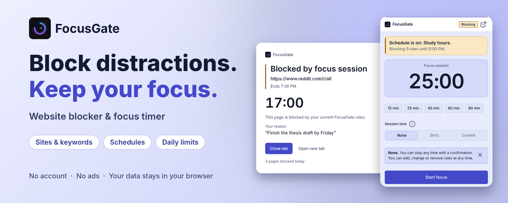
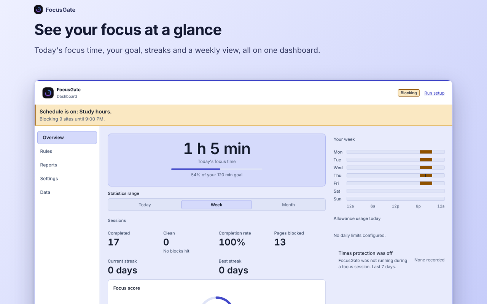
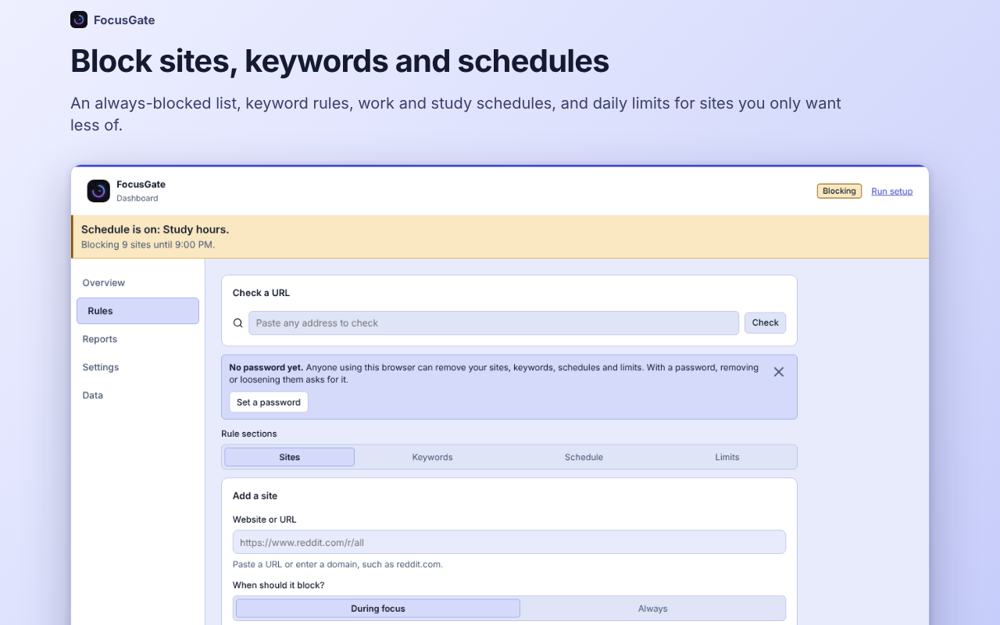
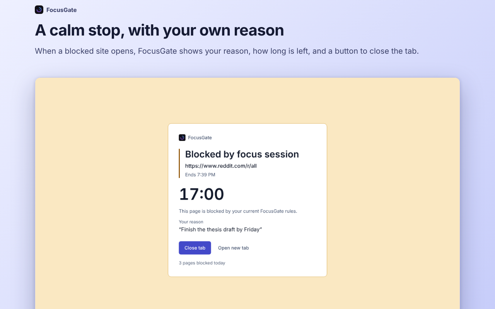
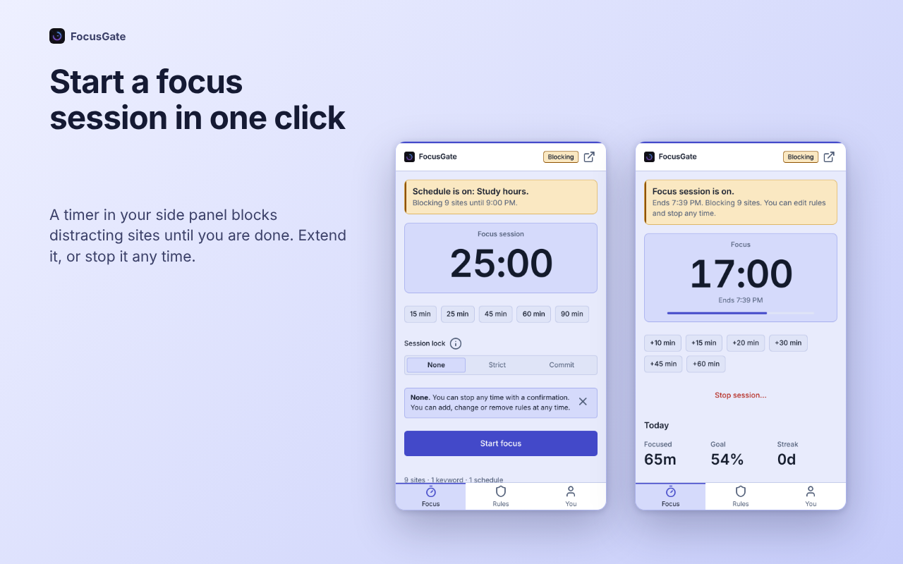
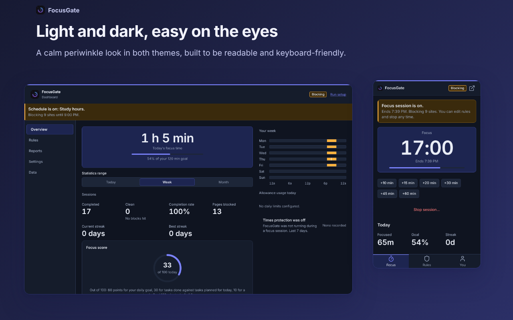
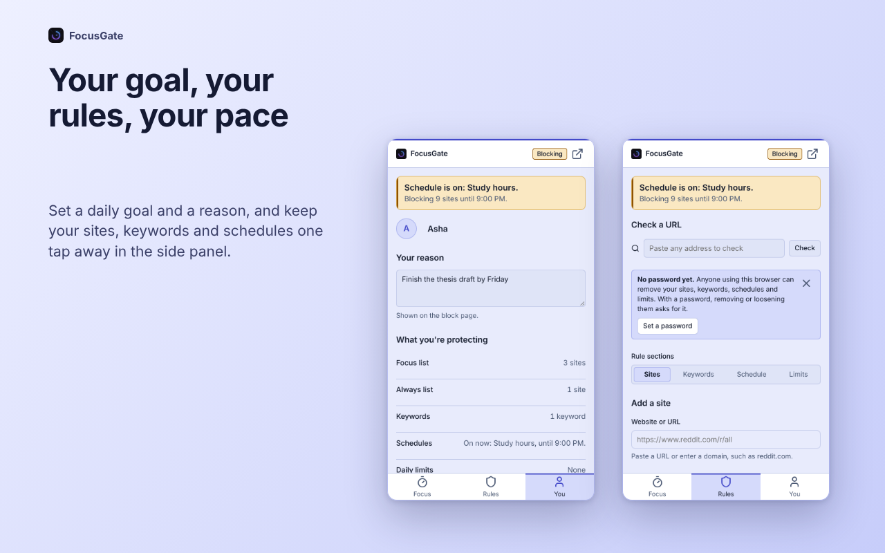

<p align="center">
  
</p>

<h1 align="center">FocusGate: Website Blocker &amp; Focus Timer</h1>

<p align="center">
  <b>Block distracting websites. Keep your focus.</b><br>
  A free, open-source website blocker and focus timer for Chrome, Edge and Firefox.<br>
  No account. No ads. Your data stays in your browser.
</p>

<p align="center">
  <a href="https://addons.mozilla.org/en-US/firefox/addon/focusgate-web/"><b>Add to Firefox</b></a> &nbsp;&middot;&nbsp;
  <a href="https://microsoftedge.microsoft.com/addons/detail/mmjhejklaaljidnmabjiloceniacihkk"><b>Add to Edge</b></a> &nbsp;&middot;&nbsp;
  <a href="https://github.com/TITANICBHAI/FocusGate/releases/latest/download/focusgate-chrome.zip"><b>Download for Chrome</b></a>
</p>

<p align="center">
  <a href="https://github.com/TITANICBHAI/FocusGate/releases/latest"></a>
  <a href="LICENSE"></a>
  
  
</p>

<p align="center">
  
</p>

## What is FocusGate?

**FocusGate is a free, open-source website blocker and focus timer for Chrome, Edge and Firefox.** It blocks the sites and keywords you choose during focus sessions, on schedules or all day, lets you set daily limits, and shows how much focused time you really get. Everything is stored in your browser, with no account, no ads and no analytics.

It is made for students, remote workers, freelancers and anyone who loses hours to a feed.

<p align="center">
  
</p>

## Get FocusGate

| Browser | Install | Needs |
|---|---|---|
| **Firefox** | [Add to Firefox](https://addons.mozilla.org/en-US/firefox/addon/focusgate-web/) | Firefox 140+ (Android 142+) |
| **Microsoft Edge** | [Add to Edge](https://microsoftedge.microsoft.com/addons/detail/mmjhejklaaljidnmabjiloceniacihkk) | Microsoft Edge |
| **Chrome** | [Download focusgate-chrome.zip](https://github.com/TITANICBHAI/FocusGate/releases/latest/download/focusgate-chrome.zip) | Chrome 116+ |

Firefox and Edge install from their official add-on stores and update themselves. FocusGate is not on the Chrome Web Store, so Chrome installs from the GitHub release:

1. Download **focusgate-chrome.zip** from the [latest release](https://github.com/TITANICBHAI/FocusGate/releases/latest) and extract it to a folder you will keep.
2. Open `chrome://extensions` and turn on **Developer mode**.
3. Choose **Load unpacked** and select the folder that contains `manifest.json`.
4. Pin FocusGate and click its icon to open the side panel.

> Keep the folder where it is, because Chrome runs the extension from it. Export a backup in Settings before you move it or load it from a new place. Chrome does not update this install for you: download the new zip, replace the files in the same folder and press reload on `chrome://extensions`.

## Features

### Block what pulls you away

- **Websites.** A focus list for sessions and schedules, plus an always-blocked list that works all day. Related addresses such as x.com and twitter.com share one entry.
- **Keywords.** Block searches and pages that match, or hide matches on supported pages such as YouTube and Google Search.
- **Schedules.** Work hours, study time or sleep, on any days and hours, including overnight. Start from a template and see your whole week at a glance.
- **Daily limits.** Give a site a time or page-open budget. When it runs out, the site blocks.

<table>
  <tr>
    <td width="50%"></td>
    <td width="50%"></td>
  </tr>
  <tr>
    <td align="center"><sub>Block sites, keywords and schedules</sub></td>
    <td align="center"><sub>A calm stop, with your own reason</sub></td>
  </tr>
</table>

### Focus on purpose

- **A focus timer in your side panel** (the sidebar in Firefox). Start in one click, extend it or stop it. A card says what is on, when it ends and what is blocked.
- **Session locks.** **None** lets you stop any time. **Strict** needs your password to stop early (or the phrase "I GIVE UP" and a 15-second wait if you have not set one). **Commit** has no early stop.
- **Block now.** A timed block with no early stop. Pick sites and an end time, from 5 minutes to 30 days, up to 500 sites. It never uses your password. While it runs, nothing can be removed or loosened and your data cannot be reset.
- **A block page that remembers why.** It shows your own reason, how long is left and a Close tab button.
- **A daily goal that counts.** Sessions you stop early are shown, but only finished time counts toward your goal, streak and achievements.

<table>
  <tr>
    <td width="50%"></td>
    <td width="50%"></td>
  </tr>
  <tr>
    <td align="center"><sub>Start a focus session in one click</sub></td>
    <td align="center"><sub>Light and dark, easy on the eyes</sub></td>
  </tr>
</table>

### See your progress

Today, week and month views, focus score, streaks, pages blocked, the sites that tried hardest to distract you, weekly reports, daily mood notes, habits and achievements.

<p align="center">
  
</p>

### Also

- **Content filters (Beta, off by default).** Hide YouTube Shorts, the YouTube home feed, suggested videos and comments, Instagram Reels and Explore, X trends, the TikTok feed, the LinkedIn feed, and posts that contain your hide words. They depend on each site's page layout, so they can break when a site changes.
- **Keyboard shortcuts.** `Alt+Shift+F` starts or stops a focus session. `Alt+Shift+B` blocks the site you are on. Change them in your browser.
- **Light and dark themes**, built for keyboard and screen-reader use.
- **Backup.** Export and import your rules and history from Settings.

## Private by design

No account, no ads, no analytics and no remote servers. Your rules, history and settings are stored in your browser, and FocusGate keeps only a scrambled copy of your password. It reads page addresses on your device only to apply your rules, and nothing is sent anywhere. The Firefox build declares that it collects no data. Read the [privacy policy](docs/privacy-policy.html) or the source to check.

## Good to know

- FocusGate needs access to all websites so your rules can apply to any site you add.
- A lock slows you down; it does not make removal impossible. Someone with access to your browser can still disable the extension.
- On Firefox for Android there is no sidebar, so the toolbar button opens FocusGate in a tab, and features Android lacks (notifications, shortcuts, idle detection) are skipped.

## FAQ

**Is FocusGate free?** Yes. It is free and open source under the MIT licence, with no ads and no account.

**Is it on the Chrome Web Store?** No. Chrome installs from the [GitHub release](https://github.com/TITANICBHAI/FocusGate/releases/latest) in about a minute (steps above). Firefox and Edge install from their official stores.

**Does it collect my data?** No. Everything stays in your browser.

**Can I block a site only during work hours?** Yes. Use a schedule: pick the days, the hours and the sites.

**What is the difference between a focus session and Block now?** A focus session can use a lock (None, Strict or Commit) and is tied to your timer and daily goal. Block now is a plain timed block with no early stop that never asks for a password.

**How do I report a bug?** [Open an issue](https://github.com/TITANICBHAI/FocusGate/issues) with your browser and version, the FocusGate version and the steps to reproduce it. Please leave out private browsing history.

More answers are on the [FAQ page](docs/faq.html).

## Contributing and support

Issues and pull requests are welcome. See [Support](docs/support.html) for what to include in a bug report, and [`CHANGELOG.md`](CHANGELOG.md) for what changed in each version.

FocusGate is published by TBTechs under the [MIT licence](LICENSE).

---

# For developers

FocusGate is a Manifest V3 extension built with React, TypeScript and Vite. The compiled extension is the contents of `dist/`; browser-specific ZIPs are written to `build/`.

## Project layout

- `src/background/`: the service worker (blocking rules, sessions, alarms, storage guard)
- `src/content/`: content scripts (keyword and content filters)
- `src/ui/`: side panel, dashboard, setup and block page (React)
- `src/shared/`: types, state, gating and helpers shared by all of them
- `public/manifest.json`: the Chromium manifest; `scripts/firefox-manifest.cjs` derives the Firefox one
- `scripts/`: build, packaging and release scripts
- `tests/`: Vitest tests
- `docs/`: the website (generated, see below)
- `release-notes/`: the short highlights shown on each GitHub release page
- `store-assets/`: store icon, screenshots and promotional images

## Build locally

Requirements: Node.js 20+ or Bun, and the `zip` command (available by default on GitHub's Ubuntu runners).

```bash
npm install
npm run package:all
```

With Bun, use `bun install` and `bun run package:all`.

The ZIPs are ready to load after extraction because `manifest.json` is at the archive root. Do not upload the repository ZIP or the `dist` folder wrapped in another parent folder. `npm run package:all` also creates `build/store-submission/`, containing all three browser packages, the MIT licence, listing copy, icon and store screenshots.

Useful commands:

```bash
npm run dev          # run the UI locally
npm test             # Vitest
npm run typecheck    # tsc for the extension and the UI
npm run build        # build the extension into dist/
```

## Install an unpacked build

**Chrome or Edge:** extract the browser-specific ZIP to a permanent folder, open `chrome://extensions` or `edge://extensions`, enable **Developer mode**, choose **Load unpacked** and select the folder that contains `manifest.json`.

**Firefox:** `npm run package:firefox` (after `npm run build:extension`) writes `build/focusgate-firefox.zip` with a Firefox manifest: a background script instead of a service worker, a sidebar instead of the Chrome side panel and a stable add-on ID. For temporary testing, open `about:debugging`, choose **This Firefox** then **Load Temporary Add-on**, and select the extracted `manifest.json`. Firefox asks you to grant site access in its Add-ons manager.

## GitHub Actions build

The workflow [`.github/workflows/build-extension.yml`](.github/workflows/build-extension.yml) runs on pushes to `main` or `master`, pull requests, version tags beginning with `v`, and manual dispatches. Every run uploads three separate browser artifacts (`focusgate-chrome-...`, `focusgate-edge-...`, `focusgate-firefox-...`). GitHub wraps Actions artifacts in a download ZIP; that wrapper cannot be disabled.

To get the browser ZIPs without a wrapper, push a version tag such as `v1.0.2`. The workflow builds, validates and attaches `focusgate-chrome.zip`, `focusgate-edge.zip` and `focusgate-firefox.zip` to a GitHub Release, using the release page described below.

## Making a GitHub release

The release page is a short product page, not a pasted changelog: a banner, the Firefox, Edge and Chrome buttons, a "What's new" list, the Chrome install steps, the three files, and the full changelog tucked into a collapsed block.

1. Add the version's section to `CHANGELOG.md`.
2. Add `release-notes/<version>.md` with a tagline and short bullets (see [`release-notes/README.md`](release-notes/README.md)). Without it, the first sentence of each changelog paragraph is used.
3. Commit everything, including `store-assets/marketplace/`, and push the tag, or publish from a finished build:

```bash
node scripts/release-notes.cjs --tag v1.0.2    # preview the release page
npm run release:github -- --dry-run            # check the files, publish nothing
npm run release:github                         # publish (needs the GitHub CLI, signed in, and unzip)
```

`npm run release:github` can also run from GitHub (Actions, **Publish GitHub release**). Options: `--dry-run`, `--draft`, `--run <id>`, `--tag`, `--repo`. If the release already exists, its files and page are replaced.

See [`STORE_PUBLISHING.md`](STORE_PUBLISHING.md) before submitting to a store, and [`AFTER_PUBLISHING.md`](AFTER_PUBLISHING.md) for the upload and post-approval checklist.

## The website

`docs/` is a static site (plain HTML and CSS, no JavaScript) that reuses the extension's design tokens. The pages, `sitemap.xml`, `robots.txt`, `llms.txt` and `llms-full.txt` are generated from `tools/site/`:

```bash
npm run site:build                                   # writes docs/
SITE_URL=https://your.domain npm run site:build      # when it is published somewhere else
```

Edit `tools/site/data.mjs` (facts, FAQ, links) or `tools/site/build.mjs` (layout and pages), then rebuild; do not edit the generated HTML by hand. The default base URL is `https://titanicbhai.github.io/FocusGate`. Preview it with `npm run docs:dev`.

## GitHub sync from Replit

The Replit project includes a `FocusGate GitHub Sync` one-shot workflow. It commits tracked changes and pushes them to `https://github.com/TITANICBHAI/FocusGate`, then exits. GitHub Actions builds separately. The workflow reads `GITHUB_PERSONAL_ACCESS_TOKEN` only from Replit Secrets; the token is never stored in the repository or the Git remote URL. Secrets do not travel with GitHub commits, so add the token again after importing the project into a different Replit account.
